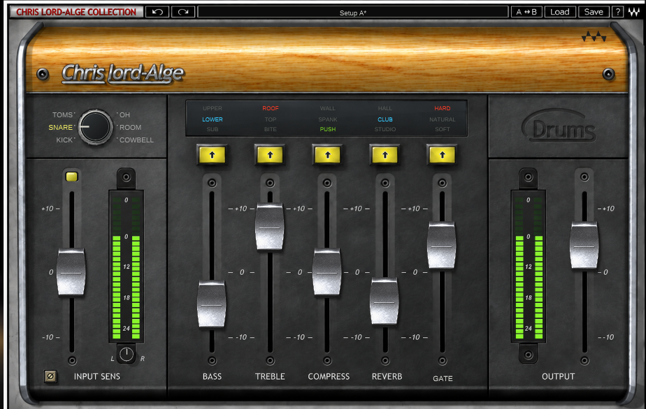

# CLA Drums 0.3.0 — Windows x64 VST3

[Baixar VST3 compilado para Windows 64 bits](https://github.com/aulamix001/CLA-DRUMS/raw/refs/heads/downloads-v0.3.0/downloads/CLA-Drums-0.3.0-Windows-x64.zip)

A versão 0.3 recria o painel conforme a referência, com madeira e metal texturizados, moldura e divisórias em relevo, sete faders móveis com sprites de prata e sombra, seletor giratório, botões amarelos e visor de modos. Os valores numéricos aparecem durante interação. São 26 presets mapeados; Gate vira Delay no Cowbell. A barra superior inclui presets, undo/redo, A/B e Load/Save.

Os assets são recriados; identidade visual pixel a pixel não foi estabelecida. O processamento sonoro é autoral. O ZIP contém um VST3 real PE x86-64, compilado em C++17/JUCE 7.0.12. Os testes de áudio, estado, presets, controles e escala da interface passaram no Linux. Falta validar carregamento e reprodução em uma DAW Windows.

## Instalar

1. Baixe e extraia o ZIP.
2. Copie a pasta inteira `CLA Drums.vst3` para `C:\Program Files\Common Files\VST3`.
3. Reescaneie os plugins na DAW e insira o efeito em uma pista de áudio.

Clique nas setas amarelas para trocar o modo; clique direito para ativar/desativar o módulo. Arraste o seletor ou clique no nome da peça. Clique no título da coleção para Direct/Wet, ou clique direito para bypass. Clique nos medidores para zerar clip. O logo temporário do JUCE pode aparecer na inicialização e desaparecer normalmente.

[Interface Cowbell em 2×](preview/CLA-Drums-0.3.0-Cowbell-2x.png). Checksums em `downloads/SHA256SUMS.txt`. A versão 0.2 permanece disponível na branch `downloads-v0.2.0`.
